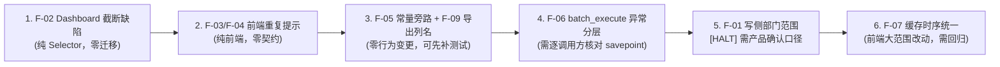

# AssetManagementProgram 全项目审查报告

> 审查对象：`asset_management_backend`（Django/DRF）+ `vue-assetmanagement`（Vue3/TS）
> 审查方式：静态阅读源码 + 规范比对 + 交叉验证（前后端契约、状态机、权限、缓存）
> 审查日期：2026-10-31
> 审查工具链：未执行（只读审查，无终端）——所有覆盖率/门禁结论标注为「未执行」，不编造数字

## 0. 结论摘要

| 项 | 结论 |
|:---|:---|
| 总体评级 | **B+（可交付，存在 1 项需产品确认的授权不对称 + 6 项应迭代内修复的缺陷）** |
| 架构健康度 | 良好。后端严格分层（`models/selectors/services/serializers/views/state_machine`），前端 API→Store→Composable→View 四层清晰，未发现跨层倒挂 |
| 状态机治理 | 优秀。唯一入口 + 未登记资产显式白名单 + 全路径单测，是项目最强的一环 |
| 跨端契约 | 一致（8 个状态枚举、响应根结构、分页参数、时间格式均对得上），零破坏 |
| 安全红线 | 未发现 SC-1/SC-3/SC-4/SC-5/SC-6 违规；配置硬化程度高于同类项目 |
| 主要风险 | ① 写侧无部门范围校验（读侧有）；② Dashboard 先截断后过滤导致结果不完整；③ 前端多处重复提示与缓存失效时序分叉 |
| 阻断级问题 | **0 项**（未发现可导致数据损坏或提权的确定性缺陷） |

**必须先说明的执行边界（Fact-1）**：本次为只读审查，**未执行** `pytest` / `vitest` / `ruff` / `mypy` / `vue-tsc` / `codegraph` / `check_duplicate_invariants.py`。因此 **CT-2 覆盖率数字、CT-5 测试结论、CT-7 门禁复核一律标记为「未执行」，不作为结论**。下文所有缺陷均来自源码直读，附文件:行号可复核。

---

## 1. 架构与框架评估

### 1.1 后端分层（`asset_management_backend`）

```
config/          settings(base/dev/prod) + urls + 中间件
core/            横切：permissions / department_scope / pagination / exception_handler
                 batch_mixins / excel_export / constants / request_context(trace_id)
apps/
  assetmanagement/   models(15) selectors(13) services(13) serializers(13) views(18) state_machine(9)
  usermanagement/    员工 / 部门 / 角色 / 权限码
  authusermanagement/ JWT 双通道（bearer + httpOnly cookie）
  unregisteredasset/ 未登记资产（独立状态机，不进主 FSM）
  notification/      WebSocket + 站内通知
```

- **依赖方向正确**：`views → services → selectors/models`，未发现 Service 反向依赖 View；横切逻辑收敛在 `core/`，11 个导出端点共用 `core/excel_export`（DR-1 落实）。
- **横切能力齐备**：`trace_id` 中间件（OC-1/OC-2）、`/health` `/ready`（OC-6）、Prometheus 指标端点、全局异常处理器统一 `{code,data,message}`。
- **架构待议（P3）**：`assetmanagement` 单 app 承载 **15+ 业务域**（资产/合同/仓库/类型/出库/回收/损坏/报废/维修/遗失/找回/硬盘SN/操作日志），215 个 `.py`。当前按层分目录尚可维护，但域边界仅靠文件名约定，建议后续按 `assets/` `contracts/` `lifecycle/` 拆子包（不改变分层）。

### 1.2 前端分层（`vue-assetmanagement/src`）

```
api/         request.ts（拦截器/刷新单飞/错误归一） + 20+ 域 API 模块 + assetCache
stores/      createEntityStore 工厂 + 18 个域 store
composables/ usePaginationSearch / useAssetOperationForm / useAssetLifecycleActions ...
components/  commoncomponents(原子) + componentsdetails(业务)
views/       16 个页面 + system/
```

- **单一请求出口**：全仓无绕过 `request.ts` 的裸 `axios` 调用（`src` 内 `axios` 仅出现在 `request.ts`/`tokenRefresh.ts` 及测试）。
- **Store 工厂化**：`createEntityStore` 统一分页/并发 seq/缓存/local 清理，18 个 store 无重复实现（DR-1/DR-2 达标）。
- **待议（P3）**：`assetStore` 用「首次调用时给 store 挂方法」的猴子补丁模式（`stores/assetStore.ts` 内 `if (!('searchAssets' in store))`），类型上用 `as unknown as` 断言穿透，可读性与可测试性弱于工厂显式声明方法。

---

## 2. 五张矩阵

### M1 模块 × 风险热力

| 模块 | 架构 | 逻辑 | 安全 | 性能 | 测试 | 综合 |
|:---|:---:|:---:|:---:|:---:|:---:|:---:|
| state_machine | ● | ● | ● | ○ | ● | **A** |
| core/(权限/范围/分页/异常) | ● | ● | ● | ○ | ● | **A** |
| assetmanagement services | ● | ◐ | ◐ | ◐ | ● | **B+** |
| assetmanagement views | ◐ | ◐ | ◐ | ○ | ● | **B** |
| usermanagement | ● | ● | ● | ○ | ● | **A−** |
| authusermanagement | ● | ● | ● | ○ | ● | **A** |
| unregisteredasset | ● | ● | ● | ○ | ● | **A−** |
| 前端 api/ 层 | ● | ◐ | ● | ○ | ● | **B+** |
| 前端 stores/ | ● | ● | ○ | ◐ | ● | **B+** |
| 前端 views/components | ◐ | ◐ | ● | ◐ | ● | **B** |

（● 良好 / ◐ 有可改进点 / ○ 无显著问题）

### M2 跨端契约核验（§3）

| 契约项 | 后端 | 前端 | 结论 |
|:---|:---|:---|:---:|
| 响应根结构 `{code,data,message}` | `utils/response_utils.py`；views 零裸 `Response`（仅 `public_scan_view` 用统一 helper） | `api/request.ts` 拦截器统一解包 | ✅ 一致 |
| 资产状态 8 枚举 | `models/asset.py:81-90` | `types/asset.ts:45-53` | ✅ 逐字一致 |
| 分页参数 `page`/`page_size` | `core/pagination.py` | 全 store 统一 | ✅ 一致 |
| 时间格式 ISO8601 `+08:00` | DRF `ISO_8601` + `TIME_ZONE=Asia/Shanghai` | `utils/Format` | ✅ 结构一致（**未运行验证**） |

### M3 状态机全路径（CT-3）

```32:45:asset_management_backend/apps/assetmanagement/state_machine/transitions.py
VALID_TRANSITIONS: dict[AssetState, dict[AssetState, str | tuple[str, ...]]] = {
    # 在库 → 在用(首次出库)、已损坏、已遗失
    AssetState.IN_STORE: {
        AssetState.IN_USE: "outasset",
        AssetState.BROKEN: "mark_broken",
        AssetState.LOST: "mark_lost",
    },
    # 在用 → 待发放(回收)、已损坏、已遗失
    # 【业务决策】in_use 不允许直接申请报废,须先回收(recycle → recycled_pending)再申请报废
    AssetState.IN_USE: {
        AssetState.RECYCLED_PENDING: "recycle",
        AssetState.BROKEN: "mark_broken",
        AssetState.LOST: "mark_lost",
    },
```

| 流转 | 唯一入口 | 单测 | 结论 |
|:---|:---|:---:|:---:|
| in_store→in_use | `out_asset_service` → `AssetFSM.outasset` | ✅ | ✅ |
| in_use→recycled_pending | `recycle_asset_service` → `AssetFSM.recycle` | ✅ | ✅ |
| recycled_pending→in_use | 出库/发放 | ✅ | ✅ |
| */→broken、*/→lost | `mark_asset_broken` / `mark_asset_lost` | ✅ | ✅ |
| recycled_pending→damaged | `scrapping.to_damaged`（in_use 显式禁止） | ✅ | ✅ |
| damaged→scrapped | `damaged_asset_service.approve` → `AssetFSM.approve` | ✅ | ✅ |
| damaged→original（驳回/取消） | `_resolve_revert_target` + `reject_to_original`，含 `repairing` 搁浅自愈 | ✅ | ✅ |
| broken→repairing→recycled_pending / repair*→broken | `repair_asset_service` | ✅ | ✅ |
| lost→recycled_pending（找回） | `found_asset_service` | ✅ | ✅ |

补充：`services/` 与 `views/` 内**无一处**直接赋值 `asset_current_status`（除 FSM 内部与 `unregistered` 显式白名单），CT-3 主约束成立。

### M4 安全红线（SC）

| ID | 结论 | 证据 |
|:---|:---:|:---|
| SC-1 密钥硬编码 | ✅ | 生产代码零命中；`config/settings/base.py:212-216` 明确不在 base 物化 `SIGNING_KEY` |
| SC-2 CI 扫描 | ✅（配置层） | `.github/workflows/security-scan.yml` 存在；**本次未执行** |
| SC-3 SQL 注入 | ✅ | 全仓无 `.raw()`/字符串拼接查询；`scripts/clear_database.py` 用 `psycopg2.sql.Identifier` |
| SC-4 动态表名 | ⚠️ 低风险 | `clear_database.py` 表名来自 DB introspection，非用户输入；仅维护脚本 |
| SC-5/SC-6 上传 | N/A | 后端无文件落盘（导入在内存解析 JSON），不适用 |
| SC-7/SC-8 依赖审计 | 未验证 | 有 workflow，未运行 `pip-audit`/`npm audit` |
| 附加：开放端点 | ✅ | 仅 6 个 `AllowAny`（注册/登录/刷新/登出/公开扫码），公开扫码仅 6 字段白名单 + 限流（`views/public_scan_view.py:21-54`） |
| 附加：越权防护 | ✅ | `core/permissions.resolve_viewset_permissions` 对未知 action **fail-closed**；AUD-21「自注册→全量可见」缺口已修（`core/department_scope.py:36-77`） |

### M5 复用与技术债（DR/BR）

| 项 | 状态 | 说明 |
|:---|:---:|:---|
| DR-1 业务逻辑唯一实现 | ⚠️ | 发现 **8 处** `max_batch_size=100` 字面量旁路常量（见 F-05） |
| DR-2 UI 原子化 | ✅ | `commoncomponents/` 复用；`useAssetLifecycleActions` 已收敛 4 页重复逻辑 |
| DR-3 查询统一入口 | ✅（1 处瑕疵） | `contract_view.py:109` 仍直接 `Contract.objects.filter` |
| DR-4 工具函数 | ✅ | `utils/` 单一仓库 |
| DR-5 文件规模 | 未验证 | 台账 `FR5_vue_ledger.md` 记录全部 `.vue` < 500 有效行；**本次未运行护栏** |
| BR-4 函数规模 | ⚠️ 存量 | 台账已登记：`recycle_asset_service.py` `_finalize_broken_or_lost()` 53 行 / `create_recycle_asset()` 52 行未修复（`complete-patterns.md:408`） |

---

## 3. 缺陷清单

### P1

#### F-01【授权不对称】资产创建路径未做部门范围校验

**位置**：`views/asset_view.py:132-139`、`serializers/asset_crud_serializers.py:246-273`

```132:139:asset_management_backend/apps/assetmanagement/views/asset_view.py
    def create(self, request: Any, *args: Any, **kwargs: Any) -> Response:
        serializer = self.get_serializer(data=request.data)
        serializer.is_valid(raise_exception=True)
        assets = AssetService.create_asset(
            serializer.validated_data,
            operator_jobcode=resolve_operator(request.user)[0],
            operator_name=resolve_operator(request.user)[1],
        )
```

**现象**：`update_asset` 传入 `user=` 并做行级校验，`create` 不传；同时 `asset_storage` / `asset_manager` / `asset_applicant` 三个 `SlugRelatedField` 的 queryset 为**全量**（仅过滤 `is_deleted`），未按调用者部门收窄。

**影响**：`asset_admin`（本部门角色）可创建挂到**他部门**仓库/保管人的资产。因资产归属按 `manager → entry_person → storage_manager` 三路径动态解析（`core/department_scope.py:133-163`），该资产会立刻脱离创建者可见范围——表现为「创建成功但列表看不到」，且构成写入侧越权面（读侧已隔离、写侧未隔离）。

**判据待确认（ID-1）**：资产管理员代他部门录入是否为合法业务？项目内「代录」白名单目前只存在于未登记资产且限 `system_admin`（`unregisteredasset/views.py:195-199`），**主资产域无对应白名单**。[推测] 属遗漏而非设计。

**修复建议**：

1. `create` 传 `user=request.user`；`AssetService.create_asset(..., *, user)` 内对 `asset_storage_recordcode` / `asset_manager_recordcode` / `asset_applicant_recordcode` 调 `resolve_asset_department_codes` 或直接比对 `get_department_codes_for_user(user)`；
2. 或（若确需代录）显式白名单：`system_admin` 放行，其余角色校验部门；
3. 回归测试（CT-4）：`test_asset_create_cross_department_denied`（A/B 部门夹具镜像 `test_contract_read_scope.py` 范式）。

---

### P2

#### F-02【逻辑缺陷】Dashboard「即将到期 / 维护提醒」先截断后过滤，结果不完整

> **【订正 2026-10-31，融合审计批次 2 落地时复核】**：本条对**维护提醒分支**（`get_maintenance_reminders`，:332-353）的漏报判断**不成立**——合格条件「入库满 24 月」随 `asset_entry_date` 升序单调，`[:50]` 截断与先筛后取完全等价，非缺陷（已补锁定用例 `TestMaintenanceRemindersTruncation`）。**到期预警分支**（`get_expiring_assets`，:296-318）漏报判断成立并已修复（窗口超集过滤 → Python 复筛 → 排序后截断，见 `test_dashboard_alert_window.py`）。详见 `docs/Review/merge-audit-20261031.md` M-03 行订正。

**位置**：`selectors/dashboard_selector.py:296-300`、`332-336`

```296:307:asset_management_backend/apps/assetmanagement/selectors/dashboard_selector.py
        expiring_assets = (
            DashboardSelector._scoped_asset_queryset(user)
            .filter(asset_warranty_period__gt=0, asset_purchase_date__isnull=False)
            .order_by("asset_purchase_date")[:50]
        )

        result = []
        for asset in expiring_assets:
            warranty_end = asset.asset_purchase_date + relativedelta(months=asset.asset_warranty_period * 12)
            days_remaining = (warranty_end - date.today()).days

            if 0 <= days_remaining <= days:
```

**现象**：按 `asset_purchase_date` **升序**取前 50 条，再在 Python 中筛「剩余 0~30 天」。升序 = 最老的 50 条，其保修普遍已过期（`days_remaining < 0` 被丢弃）。同理 `get_maintenance_reminders` 取「入库日期最早的 50 条在用资产」，入库满 24 个月的判定同样被前 50 截断。

**影响**：资产数 > 50 时，「即将到期」列表**系统性漏报**（越新的资产越不可能进入候选），用户看到空列表或极少条目。

**修复建议**：把过滤下推到 DB（`asset_purchase_date__lte=today - 保修期` 的表达式，或用 `annotate(F('asset_purchase_date') + ...)` / 直接比较 `asset_purchase_date__lte=today - relativedelta(years=warranty)` 的不可行场景下改为先取全量再筛 + `[:N]`）；维护提醒同理用 `asset_entry_date__lte=now - 24 months`。补内容断言测试（当前无该维度断言）。

#### F-03【前端·UX 缺陷】`usePaginationSearch.loadList` 双重错误提示

**位置**：`src/composables/usePaginationSearch.ts:110-115`

```110:115:vue-assetmanagement/src/composables/usePaginationSearch.ts
    } catch (err) {
      logError('composables/usePaginationSearch', '[usePaginationSearch] Load list failed:', err)
      // [M-RC-09] 单出口：AxiosError 由拦截器已提示，仅非 AxiosError 弹一次
      notifyCallerError(err, messages.loadFailed)
      ElMessage.error(messages.loadFailed)
      throw err
    }
```

**现象**：注释声明「单出口」，实现却**无条件**再弹一次。非 `AxiosError` 走 `notifyCallerError` 弹一次 + 本行再弹 = 双 toast；`AxiosError` 已被全局拦截器提示 + 本行 = 双 toast。

**修复**：删除 `ElMessage.error(messages.loadFailed)`（保留 `notifyCallerError`），或改为 `notifyCallerError(err, messages.loadFailed)` 单一出口。

#### F-04【前端·UX 缺陷】生命周期详情页删除出现两条「成功」提示

**位置**：`src/composables/useAssetLifecycleActions.ts:67-71` + `src/stores/createEntityStore.ts:422-425`

```67:71:vue-assetmanagement/src/composables/useAssetLifecycleActions.ts
      .then(() => store.remove(recordcode))
      .then(() => {
        ElMessage.success('删除成功')
        refresh?.()
      })
```

```422:425:vue-assetmanagement/src/stores/createEntityStore.ts
        // [M-RC-10] disableAutoMessage 统一守卫：抑制时由调用方（表单/视图）负责唯一提示
        if (!config.disableAutoMessage) {
          message?.success?.(`${displayName}删除成功`)
        }
```

**现象**：`brokenAssetStore` / `lostAssetStore` / `foundAssetStore` / `repairAssetStore` 均**未**设置 `disableAutoMessage: true`（对比 `recycleAssetStore.ts:56` 已设置），故 `store.remove()` 弹「XX删除成功」，随后 composable 再弹「删除成功」。

**修复**：4 个 store 补 `disableAutoMessage: true`（与 recycle 对齐），或移除 composable 的 `ElMessage.success`。

#### F-05【DR-1】`max_batch_size=100` 字面量旁路唯一常量（8 处）

**位置**：

| 文件 | 行 |
|:---|:---|
| `services/asset_service.py` | 287 |
| `services/asset_lifecycle_mixin.py` | 426, 454 |
| `services/storage_service.py` | 180 |
| `services/out_asset_service.py` | 291 |
| `services/recycle_asset_service.py` | 365 |
| `services/contract_service.py` | 472 |
| `services/asset_type_service.py` | 223 |

**现象**：`core/batch_mixins.py:74` 已定义 `DEFAULT_MAX_BATCH_SIZE = MAX_BATCH_SIZE`，且 `batch_execute` 支持 `max_batch_size=None` 自动回落常量（`core/batch_mixins.py:111`）。调用方却显式传 `100`。

**影响**：当前数值相同无行为差异，但**唯一真值被旁路**——一旦 `MAX_BATCH_SIZE` 调整（或改为配置项），这 8 处不会跟随，正是 DR-1 禁止的形态。账本既有校验（`MAX_BATCH_SIZE = 100` 定义去重）扫不到「作为实参的字面量」。

**修复**：8 处删除 `max_batch_size=100` 实参（走默认回落），或改传 `MAX_BATCH_SIZE`。按 §1.8 新发现义务登记入账本。

#### F-06【后端·健壮性】`batch_execute` 宽 `except Exception` 吞数据库异常

**位置**：`core/batch_mixins.py:143-148`

```143:148:asset_management_backend/core/batch_mixins.py
            except Exception as e:
                # 【P1-39 修复】记录异常日志,便于生产环境排查
                logger.error(f"批量操作第 {idx} 条异常: {e}", exc_info=True)
                fail_items.append(
                    cls._make_fail_item(item_key, idx, item, "INTERNAL_ERROR", "服务器内部错误,请稍后重试")
                )
```

**现象**：`DatabaseError` / `OperationalError`（连接中断、死锁、语句错误）与业务异常同样被降级为「单条失败」继续循环。

**影响**：① 若 `process_fn` 内无 `transaction.atomic()` savepoint，PostgreSQL 事务已中止，后续每条的失败日志都被污染为 `current transaction is aborted`，`success_items` 与最终落库结果可能不一致；② 基础设施故障被伪装成「数据问题」，掩盖告警。

**修复**：在 `except Exception` 之前显式捕获 `django.db.DatabaseError` 并 `raise`（fail-fast），或在文档中强制约定所有批量 `process_fn` 必须内部包裹 savepoint 并加测试锁定。

#### F-07【前端·一致性】资产缓存失效存在两套时序（18 处 fire-and-forget vs 14 处 await）

**位置**：`api/assetCache.ts:128-131`（契约声明）vs 实际实现

| 类别 | 时序 | 代表位置 |
|:---|:---|:---|
| M-CACHE-1（单删/批删） | `await unwrapResponse(...)` 成功后失效 ✅ | `damagedAsset.ts:86-88`、`outAsset.ts:138-140`、`recycleAsset.ts:94-97` |
| M-RC-08（状态变更类） | **先失效、后请求**（未 await） | `brokenAsset.ts:46-47, 83-86`、`damagedAsset.ts:62-63, 138-142, 157-160`、`lostAsset.ts:59-60, 114-117, 151-154, 175-178`、`foundAsset.ts:44-45`、`repairAsset.ts:62-63, 136-139, 157-160, 174-177`、`recycleAsset.ts:64-67, 134-137`、`outAsset.ts:99-100, 172-177` |

**现象**：同一类「写端点成功后失效缓存」的职责，两种时序并存。`assetCache.ts:130-131` 只对 14 处 M-CACHE-1 声明了「await 后再失效」，18 处 M-RC-08 仍是发出请求即失效。

**影响**：失效发生在响应之前，若此时有并发读（列表轮询、详情 prefetch、另一个标签页）命中并回填，缓存会持有**写前数据**直到 TTL（`cacheTTL 5min`），表现为「操作成功但数据未变」，易诱发重复提交（重复出库/回收单）。

**修复**：M-RC-08 也改为 `async` + `await` 后失效（与 delete 范式统一）；或在契约表显式区分两类时序并说明竞态窗口为何可接受。

#### F-08【后端·数据范围不一致】Dashboard 合同统计未按部门隔离

**位置**：`selectors/dashboard_selector.py`（`get_statistics` / `get_overview_statistics` 内 `Contract.objects.filter(is_deleted=False)`）

**现象**：资产类统计全部经 `_scoped_asset_queryset(user)` 收窄，合同总数/金额统计为全公司口径。合同读权限已锁定为 `system_admin`（`test_contract_read_scope.py`），但 Dashboard **聚合数字**对 `dept_manager`/`asset_admin` 可见。

**影响**：部门级角色可推断全公司合同数量与金额量级，与「合同读需 system_admin」的授权模型矛盾。

**修复**：合同统计对非 `system_admin` 返回 `None` 或按部门（合同无部门字段时返回 0 并说明），并补断言测试。

---

### P3

| ID | 位置 | 问题 | 建议 |
|:---|:---|:---|:---|
| F-09 | `views/damaged_asset_view.py:67` | 导出列 `"field": "damaged_asset_date"`，模型字段实为 `damaged_date`（`models/damaged_asset.py:72`）。`get_nested_value` 用 `getattr(..., None)`（`core/excel_export/workbook.py:39-46`），**静默输出空列**「损坏日期」 | 改字段名；补内容断言测试（现有测试只断言权限，未断言单元格） |
| F-10 | `views/asset_view.py` 各 `@action(permission_classes=...)` | 视图覆写了 `get_permissions()`，`@action` 的 `permission_classes` 不再生效，属**误导性死配置**（当前未造成越权，因解析器 fail-closed） | 删除装饰器参数或加注释说明由 `get_permissions` 统一裁决 |
| F-11 | `views/asset_view.py:483, 499, 513, 528-533, 543-546`、`494/508/520` | 函数内 `import`（`serializers`/`services`/`success_response` 与模块级重复）+ 三条英文 message（`Asset sent for repair` / `Repair completed` / `Repair failed`）混入中文体系 | 上提为模块级导入；message 统一中文 |
| F-12 | `views/asset_view.py` 的 `mark-broken/mark-lost/found/repair*` vs `views/_lifecycle_base.py` 的 `/broken-assets/` 等 | 同一业务动作暴露**两套端点**（逻辑同源，非重复实现，属 API 面冗余） | 明确主入口，旧端点标 `deprecated=True`（已有先例：`change_status`） |
| F-13 | `assetmanagement/audit.py:60-120` | 审计日志写入失败被吞并仅记 error，主流程继续 | 属明确权衡，但合规场景下「审计缺行」不可接受；建议：关键流转（approve/scrap）改为强一致，或加指标 `audit_write_failed` 告警 |
| F-14 | `serializers/asset_crud_serializers.py:363-393` | 操作日志 API 输出 `ip_address` | 如需保留供审计，限制为 `system_admin`/`auditor` 可见 |
| F-15 | `stores/assetStore.ts:144-147` vs `:173` | `getList()` 无参回落 `page_size: 10`，store 配置为 `defaultPageSize: 20` | 统一取 `defaultPageSize` |
| F-16 | `vue-assetmanagement/package.json:26` | `@vue/server-renderer` 在 `src` 内零引用（SSR 无关的 SPA） | 移除，减少依赖面 |
| F-17 | `vue-assetmanagement/vite.config.ts:221` | dev `server.host: '0.0.0.0'` | 仅影响开发态，建议默认 `127.0.0.1`，需要时用 `--host` |
| F-18 | `types/asset.ts:36-44` | 状态流转注释漂移：漏 `in_store→broken/lost`、`in_use→broken/lost`，且写「recycled_pending→damaged」而实际另有 `in_store→in_use` 等 | 注释与 `VALID_TRANSITIONS` 对齐（或标注「详见后端 transitions.py」） |
| F-19 | `apps/assetmanagement/operation_log_views.py` | 视图模块落在 app 根目录而非 `views/`，与其余 18 个视图不一致 | 迁移至 `views/` |
| F-20 | `recycle_asset_service.py` | 台账已登记 BR-4 存量：`_finalize_broken_or_lost()` 53 行、`create_recycle_asset()` 52 行（`complete-patterns.md:408`） | 按 BR-4 批次拆分，本次未改动该文件，不阻断 |

---

## 4. 值得肯定之处（附证据）

1. **状态机收口彻底**：`state_machine/` 8 个模块按流转族拆分，`VALID_TRANSITIONS` 作为表驱动真值 + `AssetFSM._transition` 校验 + 每族 `@transaction.atomic`；`unregistered.py` 是**显式登记**的唯一例外（`# CT-3 例外`），不是散落赋值。
2. **权限 fail-closed**：`core/permissions.py::resolve_viewset_permissions` 对未声明 action 回落默认权限而非放行；`core/department_scope.py:36-77` 把「无 Employee」从 `None（不限）` 反转为 `[]（拒绝）`，堵住自注册越权。
3. **事务与并发意识**：`create_asset` 用内层 savepoint + `match_integrity_error_rules`（`NoReturn` 语义）避免 `IntegrityError` 污染外层事务；`update_asset` 有 `select_for_update` + 锁内二次可见性校验（TOCTOU）。
4. **配置硬化**：`SECRET_KEY`/`SIGNING_KEY` 环境注入、`CSP`、CORS 白名单、JWT 黑名单 + 轮换、`anon 20/min` 限流、`drf-spectacular` 从 `AllowAny` 改为 `IsAuthenticated`。
5. **前端请求层成熟**：刷新令牌单飞（single-flight）、rotation race 重放、业务 401 与认证 401 区分、错误归一 `notifyCallerError`、`SubmitBatch` 批量提交。
6. **测试体量**：后端 75 个测试文件仅 `assetmanagement`，另有 `core/tests`、`usermanagement` 等；前端 138 个 spec 文件（台账记载 1878 tests）。CT-1/CT-3 的**存在性**成立（覆盖率数字未验证）。

---

## 5. 测试与门禁（CT）

| ID | 结论 | 说明 |
|:---|:---:|:---|
| CT-1 核心逻辑有测试 | ✅（静态） | 状态机/权限/导出/审计均有对应测试文件 |
| CT-2 覆盖率 ≥80/90 | **未执行** | 只读模式无终端，禁止编造数字 |
| CT-3 状态机全路径 | ✅（静态） | 见 M3，9 条路径均有 `test_state_machine.py` 用例 |
| CT-4 回归屏障 | ⚠️ 缺口 | F-02/F-09 类缺陷无内容断言测试；建议补测 |
| CT-5 测试失败阻塞 | 未执行 | — |
| CT-6 迁移安全 | 不适用 | 本次未新增迁移 |
| CT-7 门禁版本复核 | 未执行 | 未运行 `dev.txt` 声明的 ruff/mypy/pytest |

---

## 6. 建议修复顺序（小步验证，§1.2）



- **第 5 步触发红线判断**：若确认要做部门校验，属「新增写权限规则」，建议按 §5.2 走轻量审批并补 `[HALT]` 说明；**不改枚举/不改响应结构/不增删迁移**，不构成 §1.3 红线。
- 每个修复项按 CT-4 同步补测（先红后绿）；F-05 完成后需登记 `complete-patterns.md`（§1.8 新发现义务）。

---

## 7. 审计票

```markdown
[审计票 - 必填项]
- 读取规范：已读 根 AGENTS.md / vue-assetmanagement AGENTS.md / Rules_Fiels（BR6/FR5 台账、Duplicate 账本）
- CT-1[√静态] CT-3[√] CT-5[未执行] CT-7[未执行·只读模式无终端]
- DR-1[✗ F-05 八处常量旁路] DR-5[未执行·护栏未跑，台账记录全部达标]
- SC-1[√] SC-3[√]
- 跨端契约：未破坏（8 枚举 / 响应结构 / 分页 / 时间格式 逐项核对一致）
- 红线触发：无（F-01 若落地才需 §5.2 审批；本次仅报告未改码）
- 建议提交：是（本报告作为审查记录）

[审计票 - 自检项]
- 测试：CT-2[未执行] CT-4[⚠ 缺口] CT-6[N/A]
- DRY：DR-2[√] DR-3[⚠ contract_view.py:109] DR-4[√] DR-6[√]
- 安全：SC-2[√配置/未运行] SC-4~SC-8[√/未运行]
- 可观测性：OC-1~OC-3[√] OC-4[~] OC-5[~] OC-6[√] OC-7[~]
- AI鲁棒性：AR-1~AR-5[√ 本次零代码生成]
- AI行为：Fact-1[√]（未执行项已显式标注，未编造覆盖率）
- 写作风格：Style-1~Style-3[√]
- 覆盖率：未执行（不编造数字）
```

---

## 8. 未执行项与下一步

| 未执行 | 原因 | 建议命令（需终端） |
|:---|:---|:---|
| 后端全量测试 + 覆盖率 | 只读模式 | `pytest --cov=. --cov-fail-under=80 -v` |
| 前端测试/覆盖率 | 只读模式 | `npx vitest run --coverage` |
| 类型/lint 门禁 | 只读模式 | `ruff check . --statistics`；`npx vue-tsc --build`；`npx eslint .` |
| 复用护栏 + 行数护栏 | 只读模式 | `python scripts/check_duplicate_invariants.py`；`python scripts/check_file_length_guard.py --print` |
| CodeGraph 图谱 | 只读模式无法起 CLI | `codegraph status` / `codegraph build` |

---

## 9. 可验证性说明（Fact-2）

- `[可验证]` 全部缺陷条目均基于源码直读，附 `文件:行号`，可逐条 grep 复核 — 依据：本报告第 3 节行号引用。
- `[可验证]` 状态机 8 状态枚举前后端逐字一致 — 依据：`models/asset.py:81-90` 与 `types/asset.ts:45-53` 并读。
- `[可验证]` CT-2 覆盖率、门禁结论本次未取得 — 依据：只读审查未执行命令（第 8 节）。
- `[推测]` F-01 属遗漏而非设计 — 原因：主资产域无代录白名单，与未登记资产域的显式白名单形成对照，但未见产品口径文档。
- `[推测]` F-02 在生产规模下会系统性漏报 — 原因：逻辑为「先截断后过滤」，漏报方向由排序决定；实际影响程度取决于资产基数与保修分布，未用真实数据验证。
